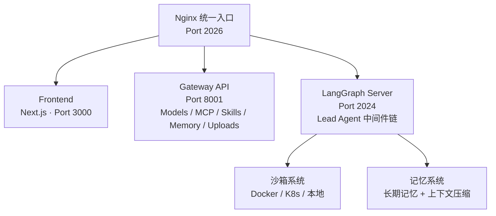

# DeerFlow 2.0 深度解析：字节的长程 SuperAgent

<span class="badge badge-done">已发布</span> <span class="badge badge-wip">定期刷新</span>

> 📅 信息截至 2026 年 11 月，基于公开资料整理，实操以官方仓库为准。GitHub：`bytedance/deer-flow`，官网：`deerflow.tech`，MIT 协议，Stars 59k+。

DeerFlow（Deep Exploration and Efficient Research Flow）是字节跳动开源的智能体框架。它 2025 年 5 月以「开源版 Deep Research」走红，2026 年 2 月 28 日发布的 2.0 版**彻底重写、与 1.x 零共享代码**，登顶 GitHub Trending，定位也从研究工具升级为「Super Agent Harness」。

## 为什么重写：被社区「用歪了」的工具

DeerFlow 1.x 是专注深度研究的框架：协调器管理流程、规划器拆任务、研究团队执行检索、报告生成器整合结果，还能把报告变成双人播客（火山引擎 TTS）和 PPT。

但社区很快拿它干起了别的事：搭数据管道、自动生成演示文稿、构建数据仪表盘、跑内容工作流……团队意识到它的价值远不止研究——**用户要的不是「查资料的工具」，而是「能执行完整任务的底座」**。于是 2.0 从零重写，官方自述：「不再是需要自行组装的框架，而是开箱即用的超级 Agent 基础设施——电池已包含，完全可扩展。」

| 对比项 | 1.x | 2.0 |
| --- | --- | --- |
| 定位 | 深度研究助手 | Super Agent Harness |
| 架构 | 单体 | LangGraph 1.0 全栈微服务 |
| 代码执行 | 无 | Docker/K8s/本地沙箱 |
| 任务时长 | 分钟级 | 分钟到小时级长程任务 |
| 扩展性 | 有限 | Markdown 技能系统 + MCP |
| 状态 | 独立分支维护中 | 主开发分支 |

## 整体架构：四层微服务



两种运行模式：

| 模式 | 进程数 | 特点 | 适用 |
| --- | --- | --- | --- |
| Standard | 4 | Gateway 与 LangGraph 分离 | 生产环境、需要 LangGraph Platform |
| Gateway | 3 | Gateway 内嵌 Agent 运行时 | 资源敏感、启动更快 |

## 核心机制拆解

### 子代理编排

长程任务的标准流程：主 Agent 分析需求 → 拆解任务 → **派出多个子代理并行执行** → 汇总交付。这是 DeerFlow 能扛「小时级任务」的关键——长任务被拆成可并行、可校验的子任务，而不是让一个 Agent 一条链路跑到黑。

### 沙箱执行

Agent 生成的代码在隔离沙箱里跑：支持 Docker、Kubernetes、本地三种模式。Docker 是默认推荐——既能执行任意代码，又把风险关在容器里。

### 长期记忆与上下文压缩

跨会话的记忆持久化，让 Agent 「越用越懂你」；上下文压缩机制则解决长程任务中上下文窗口被撑爆的问题。

### 技能系统（Markdown Skills）

技能用 Markdown 文件定义，**渐进加载**——Agent 只在需要时读入对应技能的完整说明，避免一次性把所有技能塞进上下文。这个设计与 Claude 的 Skills、OpenClaw 的技能包思路一致（联动 [OpenClaw 实战](../openclaw/)）。

### MCP 与生态

DeerFlow 是 MCP Host，可通过 MCP 接入私域搜索、知识库、Browser Use 等能力（联动 [MCP 详解](../mcp/01-mcp-detail)）。同时提供 `DeerFlowClient`，可以作为 Python 库嵌入你自己的系统。

## 部署上手

```bash
# 推荐：Docker 一键部署
git clone https://github.com/bytedance/deer-flow.git
cd deer-flow
make docker-start
# 访问 http://localhost:2026

# 本地开发模式
make dev
```

模型配置在 `config.yaml`：支持 OpenAI、OpenRouter、Codex CLI、Claude Code 等多种提供方，API Key 建议通过环境变量注入，不要硬编码进配置文件。

IM 渠道集成是它的一个亮点：**Telegram（轮询）、Slack（Socket Mode）、飞书（WebSocket）都不需要公网 IP**，在 `config.yaml` 里启用并配置令牌即可——在企业内网里部署一个「专属研究员 Agent」成本很低。

> ⚠️ **安全提示**：DeerFlow 具备代码执行与文件操作能力，官方明确建议仅在受信任的本地/内网环境部署，不要直接暴露到公网。

## 适用场景与局限

**擅长**：深度研究报告、数据管道、内容工作流、长程多步骤任务、企业内私有部署（数据主权 + 零授权成本）。

**局限**：微服务架构带来部署复杂度（对比单进程的 Harness 类工具）；编排逻辑基于 LangGraph，深度定制需要理解其图编程模型；作为「编排优先」路线的代表，它的运行时核心是不可替换的——这正是下一篇 DeepSeek Harness 要挑战的点。

## 小结

DeerFlow 2.0 的答案是：**把长程任务需要的所有基础设施（编排、沙箱、记忆、技能）全部内置，让你开箱即用**。如果你的目标是「尽快让 Agent 稳定干活」，它是 2026 年开源方案里的第一梯队。

**下一篇：《DeepSeek Harness 深度解析：一切皆插件》**——看另一条完全相反的路线。
