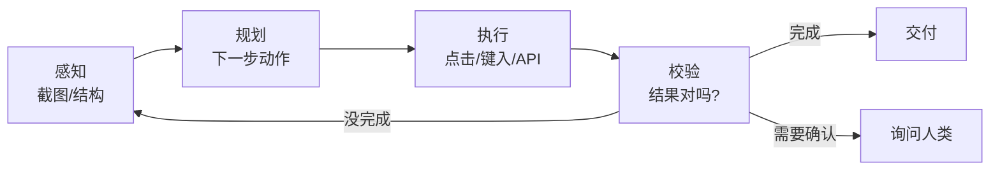

# Computer Use 原理：AI 怎么「看见」你的屏幕

已发布

前三篇讲了产品和能力，这篇往下一层：**AI 到底是怎么操作一台电脑的？** 理解原理之后，你会明白为什么有些任务它做得很好、有些必然翻车——选型和使用时心里就有谱了。

## 两条技术路线

### 路线一：截屏视觉方案

最直觉的方式，模拟人看屏幕：

1. 给屏幕截一张图
2. 视觉语言模型理解画面：按钮在哪、输入框在哪、当前是什么状态
3. 输出下一步动作：在坐标 (x, y) 点击、在某输入框键入文字、滚动页面
4. 模拟鼠标键盘执行，回到第 1 步

**优点**：完全通用，任何软件、任何界面都能「看」——包括那些没有任何接口的祖传客户端。
**缺点**：慢（每一步都要截图推理），且坐标级操作天然脆弱——窗口挪个位置、分辨率变一下、弹个广告，都可能点歪。

### 路线二：可访问性树方案

不看像素，看结构。操作系统为无障碍辅助提供了 UI 元素的结构化描述（Accessibility Tree）：这是一个按钮、那是一个输入框、它的文字是什么。

**优点**：直接拿到元素的语义和位置，比视觉识别准得多、快得多。
**缺点**：依赖应用正确暴露可访问性信息——很多自绘界面的软件（游戏、部分国产客户端）暴露得很差，网页则有更成熟的 DOM 可用。

**实践共识是混合**：能用结构化信息的优先用结构，结构拿不到再退回视觉。新一代模型如混元 Hy4 则把 Computer Use 做成了原生能力，结合命令行和图形界面两种通道。

## 从感知到行动的完整链路

无论哪条路线，Agent 的操作都是一个循环：

「校验」一环最体现工程功力：优秀的 Agent 每步之后检查屏幕状态是否符合预期，发现偏航会重试或改策略；拙劣的实现则是一路点到底，错了也不知道。

## 错误率的现状

直说：**Computer Use 还没有到完全可靠的程度**。

- 业界对 2026 年最成熟方案的估计是：简单任务错误率仍在 20% 上下，且速度明显慢于人手
- 模型侧的进步很快：混元 Hy4 在自建测试中将幻觉率从 12.95% 压到 7.2%，「猜测导致的错误率」从 23.1% 降到 5.6%
- 因此有条铁律：**能用 API 的地方绝不用鼠标**。屏幕级操作是没有接口时的兜底，不是首选

这也解释了第 03 篇里说的：为什么 MCP、技能包、连接器才是桌面 Agent 的主力通道——确定性的接口调用永远比视觉猜坐标可靠。

## 工具调用与 MCP

把概念关系理清（详见本站 [MCP 详解](../mcp/01-mcp-detail)）：

- **Computer Use**：模拟人——看屏幕、动鼠标键盘，通用但不可靠
- **MCP / 工具调用**：模拟工程师——直接调用标准化接口，可靠但需要对方提供接口

一个成熟的桌面 Agent 是「接口优先，视觉兜底」：整理文件用文件系统 API，发消息用 IM 的 MCP 服务，只有碰到没有任何接口的软件才动用 Computer Use。WorkBuddy 的「20+ 技能包 + MCP」、Claude 的「API + computer use 工具」都是这个架构。

## 沙箱与权限模型

AI 能点鼠标键盘，就意味着它能搞破坏。主流防护思路：

- **云端沙箱**：任务在隔离的虚拟机里跑，搞坏了与真实环境无关（ChatGPT 的云端方案）；代价是碰不到你的本地文件
- **本地执行 + 审批节点**：操作真实电脑，但危险动作（保存、发送、支付、删除）必须人工点头；登录和二次验证交还给你
- **权限分级**：读 / 写 / 破坏性操作分档授权，单次批准不过夜

## 现状与局限

总结这个技术的 2026 年版画像：

1. **能用了，但要选对战场**：规则明确的重复操作是好场景，开放探索型任务还太早
2. **界面是它最大的敌人**：软件改版、弹窗、分辨率变化都可能让流程失效——这也是为什么「第 100 次运行」才是试金石
3. **趋势是「视觉用得越来越少」**：随着 MCP 生态扩大、模型原生支持工具调用，靠谱的工作流会把越来越多的步骤从「点屏幕」迁移到「调接口」，Computer Use 退守真正的长尾

**下一篇：《安全与隐私边界：把电脑交给 AI 之前该想清楚的事》**
