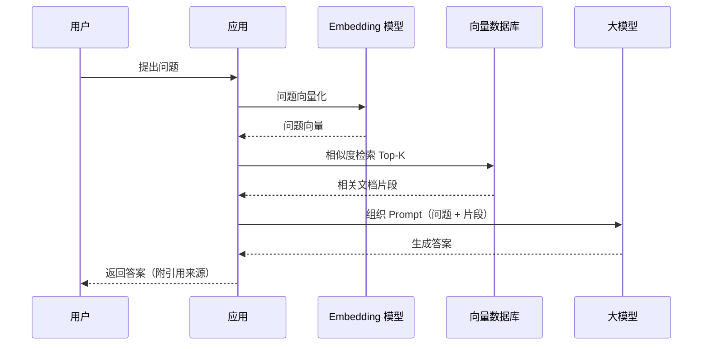

# 从存起来到用起来：知识库的三次跃迁

已发布 持续更新

每个用 AI 的人迟早都会撞上同一堵墙：**模型什么都知道，就是不知道你的事**——你的项目文档、你的合同条款、你的行业规范。知识库就是来解决这件事的。但 2026 年再谈「知识库」，含义已经和三年前完全不同。作为系列开篇，先把这条「存储 → 问答 → 执行」的演进线立起来。

## 三次跃迁

### ① 存储阶段：文件仓库

最早的「知识库」只是带搜索功能的文件夹：网盘、Wiki、笔记软件。核心动作是**存**——分门别类、打标签、建目录。痛点也很一致：存的时候很勤奋，找的时候很痛苦，用的时候基本靠记忆。知识进了库，就像书进了仓库，落灰率极高。

### ② 问答阶段：RAG 检索增强

大模型来了之后，知识库换了心脏：**RAG（Retrieval-Augmented Generation）**。文档被切片、向量化、建索引，你用自然语言提问，系统检索出相关片段喂给模型，生成有据可查的回答。

知识库的核心指标随之改变——不再是「存了多少」，而是**「问得准不准」**。腾讯 ima 的「会思考的知识库」、Dify 的知识库流水线，都是这个阶段的代表。一个精妙的总结：知识管理正在从「存储」转向「问答」，把 AI 当作你知识库的图书管理员，比手动整理标签更有价值。

### ③ 执行阶段：知识直接参与任务

2026 年的新分水岭：**知识库不再是问答的终点，而是 Agent 的弹药库**。

- ima 的 copilot 让知识库直接参与任务执行——基于你的资料写报告、做 PPT、生成配图，不用复制粘贴
- Dify 的工作流把知识检索作为节点嵌入业务流程——客服机器人先查知识库再决定话术
- WorkBuddy 式的桌面 Agent 直接调用企业知识上下文（见 [桌面助手系列](../desktop-ai/01-from-chat-to-agent)）

判断你所处的阶段很简单：**你的知识库能回答「是什么」，还是能完成「帮我做」？**

## RAG 四步流程：看懂就够了

不管产品形态怎么变，绝大多数知识库的引擎都是同一套 RAG 流程：

前 5 步是**检索阶段**（问题向量化 → 相似度搜索 → 取回片段），后 3 步是**生成阶段**（组装上下文 → LLM 推理 → 回答）。每个环节的参数选择——切多大块、用什么 Embedding、取 Top 几、要不要重排——就是第 07 篇「质量工程」的全部内容。

## 铁律：垃圾进，垃圾出

知识库项目失败，90% 不是模型不行，而是**库里的东西不行**：

- 文档过期没人清理，AI 拿着旧制度回答新问题
- 切分混乱，一句话被拦腰切断，检索回来半个意思
- 标题元数据缺失，模型分不清片段出自哪份文件
- 权限不清，敏感文档被不该看的人问出来

AI 时代「garbage in, garbage out」依然成立，甚至放大——以前烂库存着没人看，现在烂库会被 AI 理直气壮地念出来。**先治理资料，再调整模型**，是本系列反复强调的顺序。

## 知识库的类型学

选型前先想清楚你要的是哪种库：

| 类型 | 特征 | 典型产品 |
| --- | --- | --- |
| 个人知识库 | 笔记、收藏、个人文档，重隐私与便利性 | ima、Obsidian + 本地模型 |
| 团队共享库 | 多人维护、权限分级、协作沉淀 | 飞书知识库、ima 共享库 |
| 企业应用库 | 喂给 AI 应用的检索底座，重工程化 | Dify、RAGFlow、FastGPT |
| 垂直行业库 | 专业格式（图纸、GIS、合同），重解析 | 自建管线（本系列第 02 篇） |

一个常见误区：把「员工写文档的 Wiki」和「AI 读取的检索库」混为一谈。合理的企业架构通常是**知识管理平台负责生产与治理，RAG 平台负责 AI 检索与应用**——两层各司其职。

## 本系列接下来怎么写

- **第 02 篇**：我的知识库实战手记——从 SaaS 到涉密内网私有化的完整踩坑路线（真实项目）
- **第 03–05 篇**：ima / Dify / Coze 三个平台的深度专篇
- **第 06 篇**：2026 知识库平台横评与选型
- **第 07 篇**：知识库质量工程——切分、检索、治理的工程细节

**下一篇：《我的知识库实战手记：从 SaaS 验证到涉密内网私有化》**——一个地理信息从业者的真实路线。
